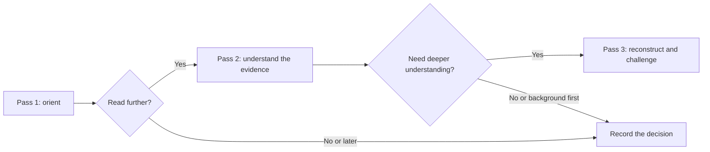

# Three-Pass Paper Reading

**English** | [简体中文](README.zh-CN.md)

A practical paper-reading skill for new researchers, distilled from **S. Keshav's 2007 _How to Read a Paper_**. Move from an overview to an evidence-based explanation, then reconstruct the work and examine its assumptions.

The repository includes the reusable skill, a reading-notes template, two worked examples, and the checks behind those examples.

## Start here

- **Use the skill:** [SKILL.md](skills/three-pass-paper-reading/SKILL.md)
- **Learn the workflow:** [the three passes below](#the-three-passes)
- **See it in action:** [worked examples and English guide](examples/README.md)
- **Read the full example reports in Chinese:** [PCB inspection](examples/pcb-defect-detection.zh-CN.md) · [agricultural detection](examples/agricultural-detection.zh-CN.md)
- **Inspect the checks:** [self-check report](validation/SELF-CHECK.md) · [36 arithmetic checks](examples/numeric-checks.json)
- **Read on your own:** [reading-notes template](templates/reading-notes.md)

## The three passes

| Pass | What you do | What you should be able to produce |
|---|---|---|
| **1. Orient** | Read the title, abstract, introduction, headings, conclusion, and glance at the references. | The **five Cs** and a decision to stop, return later, or continue. |
| **2. Understand** | Read the argument, inspect figures and tables, connect claims to evidence, and mark background reading. | An explanation of the paper supported by specific evidence. |
| **3. Reconstruct** | Rebuild the method or reasoning, compare it with the paper, recalculate important numbers, and challenge assumptions. | A reconstruction, corrections, strengths, weaknesses, and a useful next experiment. |

The five Cs are **Category, Context, Correctness, Contributions, and Clarity**. In pass 1, Correctness is an initial assessment of assumptions, not a certificate of validity.

Use **up to three passes**. A paper outside your immediate research area may need only the first pass; a paper central to your work may deserve all three.



## Use with Codex

Ask the built-in skill installer to install this directory:

```text
$skill-installer Install the skill at:
https://github.com/jiangyuhan0318-July/three-pass-paper-reading/tree/main/skills/three-pass-paper-reading
```

Then, on your next turn:

```text
$three-pass-paper-reading Read the attached paper in three passes.
Include the five Cs, a claim–evidence table with PDF page numbers,
a reconstruction of the method, unresolved questions, and a self-check.
Write the report in English.
```

For a quick screening:

```text
$three-pass-paper-reading Do a first pass on this paper.
Explain whether I should read further and which background I need.
```

You can also copy `skills/three-pass-paper-reading/` into your Codex skills directory (`$CODEX_HOME/skills`, or `~/.codex/skills` when unset). Keep the `references/` subdirectory with it. Other assistants can follow the instructions in `SKILL.md`; invocation syntax depends on the host application.

For human reading, open the [template](templates/reading-notes.md) and work through the same decisions yourself.

## What this adaptation adds

Keshav supplies the three passes, five Cs, stopping decisions, virtual reimplementation, and literature-survey strategy. This project turns them into instructions an assistant can follow and a researcher can inspect:

- Page-level claim–evidence records and original-page checks for figures, tables, and equations.
- A reconstruction written **before** checking details again, followed by explicit corrections.
- Numerical checks that distinguish percentage points, relative changes, and incompatible baselines.
- Separate records for author claims, observed inconsistencies, and untested risks.
- Usage logs and self-checks that state what was actually read or executed.

The source-to-skill mapping is documented in [method provenance](skills/three-pass-paper-reading/references/method-origin.md).

## Worked examples

The first application covered two computer-vision papers and the two-page method article: **31 PDF pages in total**. Both research papers received three-pass reviews; key figures and tables were checked visually, and **36 arithmetic checks** were recorded.

| Example | A lesson from the reading | Full report |
|---|---|---|
| PCB defect detection with YOLOv8 and CBAM | Keep baseline definitions separate: one table supports +9.5 percentage points, another +3.3. | [中文报告](examples/pcb-defect-detection.zh-CN.md) |
| Agricultural detection with STN, TPS, CBAM, and YOLO | Reconstruct the spatial-coordinate contract and check the statistical unit before accepting a significance claim. | [中文报告](examples/agricultural-detection.zh-CN.md) |

These examples document assisted reading, method reconstruction, and arithmetic verification. The authors' models were not trained or independently benchmarked. Read the [English example guide](examples/README.md) for the findings and their scope.

Recalculate the published arithmetic with Python 3, using only the standard library:

```bash
python examples/numeric_checks.py
```

The script writes `examples/numeric-checks.json`. Inputs were transcribed from the papers and checked against rendered tables; it does not extract tables or run detection models.

## Source and credit

**S. Keshav. _How to Read a Paper_. ACM SIGCOMM Computer Communication Review, 37(3), 83–84, July 2007.** The supplied 2007 version lists the **University of Waterloo** as the author's affiliation.

- [2007 paper, hosted by the University of Waterloo](https://cs.uwaterloo.ca/~Brecht/courses/856/readings/how-to-read/keshav-paper-reading.pdf)
- [Author's page, including later versions and translations](https://svr-sk818-web.cl.cam.ac.uk/keshav/publications/htrap.html)

This is an independently prepared adaptation by [July](https://github.com/jiangyuhan0318-July), developed with Codex. The reading method is credited to Keshav. The worked reports are AI-assisted learning examples with page-level evidence and explicit verification limits. Corrections with a paper version and page/table locator are welcome through GitHub issues.

## License

[MIT](LICENSE) covers the original skill instructions, templates, scripts, and commentary in this repository. Referenced papers retain their own rights and licenses. The repository links to the papers and publishes our notes; source PDFs, full extracted texts, and page screenshots are not bundled.
